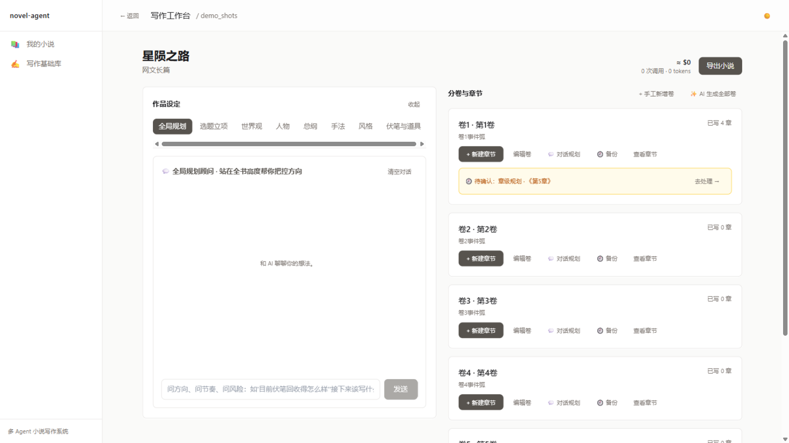
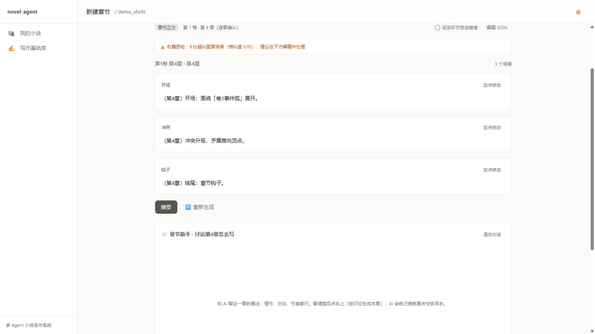
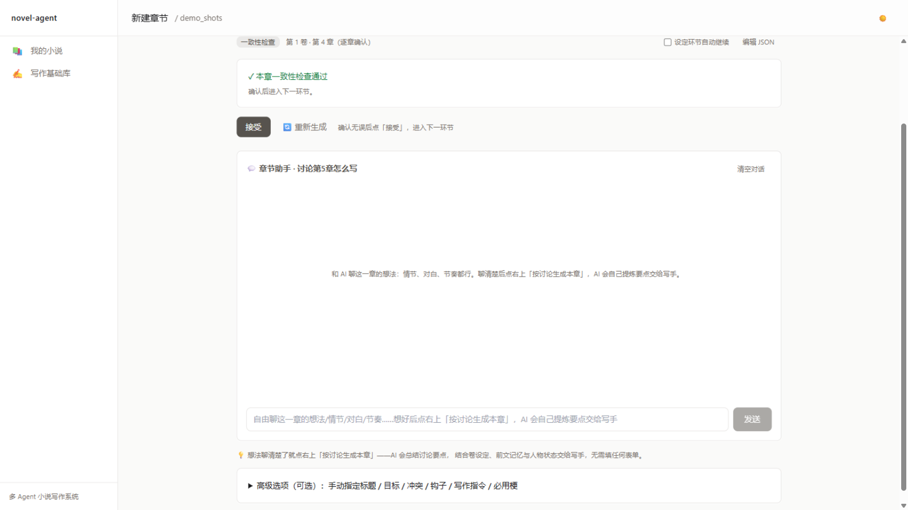
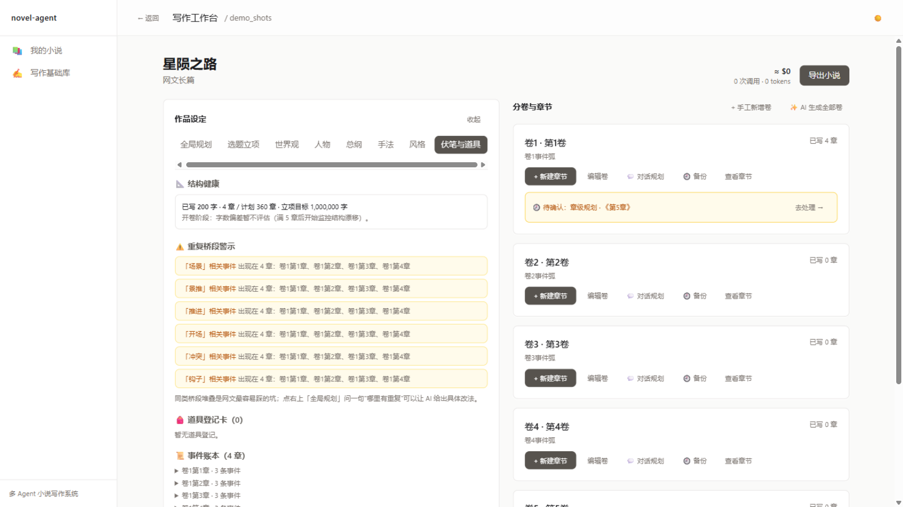

# novel-agent · 多 Agent 智能长篇小说创作系统

> **作者主导、AI 执行**：把长篇小说创作拆成 11 个确定性环节，每个环节由专职 LLM Agent 生成结构化产物，挂起等待作者确认后流入下一环节。三层记忆 + 双路检索解决长篇创作"流程失控、跨章失忆、挖坑不填"三大痛点。

**English**: novel-agent is a human-in-the-loop multi-agent pipeline for long-form novel writing, built on LangGraph. Each of the 11 stages is handled by a dedicated agent whose structured output is suspended via `interrupt()` until the author accepts / edits / regenerates it. Cross-chapter consistency is maintained by a three-layer memory system, dual-path RAG (vector + temporal knowledge graph with "no-spoiler" filtering), and a canon facts ledger. This README is written in Chinese; see [Quick Start](#-快速开始) for setup (commands are language-neutral).

---

## 项目立意

让 LLM 直接一次生成十几万字的长篇是不现实的：上下文装不下、单次输出越长质量越差、错误会级联放大、且不可控的输出无法交付。novel-agent 的答案是**把创作变成一条可控流水线**，针对三个经典痛点各有一套解法：

| 痛点 | 解法 | 实现位置 |
|---|---|---|
| 流程失控 | 11 环节流水线，每步 `interrupt()` 挂起等作者确认，SQLite checkpoint 支持随时中断恢复 | `src/novel_agent/graph/` |
| 跨章失忆 | 三层记忆（近章全文 / 章卷摘要 / 向量库）+ 双路检索（向量 ∪ 时序图谱，带"不剧透"过滤） | `src/novel_agent/memory/` `src/novel_agent/rag/` |
| 挖坑不填 | 正典事实层（事件账本 + 道具登记卡）+ 伏笔账本，规划新章时自动带回未回收的坑 | `graph/state.py` `agents/packet.py` |

## 核心特性

- **人机协同流水线**：11 个环节（选题 → 世界观 → 人物 → 总纲 → 卷纲 → 章规划 → 正文 → 一致性 → 记忆更新 → 终审 → 导出），章节级循环直到本卷完结；每个 LLM 产物都要作者 accept / edit / regenerate。
- **结构化输出兜底链**：JSON Schema 注入 → `json_object` 模式（服务端不支持自动降级）→ 容错提取（剥思考段/围栏、扫描配对括号）→ Pydantic 严格校验 → 宽松修复 → 按失败原因分流的退避重试。
- **机器质检门**：正文产出后、作者预览前，纯代码零 LLM 成本做三项检测——场景查重（difflib，跨章只看最近 3 章窗口）、节拍兑现（规划了但没写）、文风指标。只标记不阻断，裁决留给作者。
- **一致性检查与定点修复**：检查带对照资料（世界观/人物档案/前文摘要/人物状态卡），高危问题自动定点修复（只改出问题的场景），最多 3 轮熔断转人工。
- **模型分级与成本治理**：五个模型档位按岗位路由（写手 0.9 温度 / 审校 0.3），任务级改派（摘要 → 本地模型），稳定前缀吃提示词缓存，每次调用按项目/章节/模型三维度记账，前端按章露出成本。
- **确定性 mock 模式**：一个环境变量让全系统离线、免费、确定性运行——192 个单元测试与浏览器端到端全部不依赖真实 LLM。

## 界面速览

<p align="center">
  <br/>
  <em>工作台：分卷卡带"待确认"入口，AI 停在确认点等人裁决</em>
</p>
<p align="center">
  
  
</p>
<p align="center">
  <em>左：章节正文确认点（机器质检先行，作者裁决）　右：一致性检查逐章确认</em>
</p>
<p align="center">
  
</p>
<p align="center">
  <em>正典事实层：结构健康、重复桥段警示、事件账本、道具登记卡</em>
</p>

> 以上为 mock 模式演示数据。

## 架构

```
┌────────────────────────────────────────────────────┐
│  接口层   api/ — 30+ REST + SSE 任务流 + 章节对话    │
├────────────────────────────────────────────────────┤
│  编排层   graph/ — LangGraph 状态图 + 确认循环       │
├────────────────────────────────────────────────────┤
│  智能体层 agents/ — 18 个专职 LLM 任务单元           │
├────────────────────────────────────────────────────┤
│  公共能力层 llm/（分级·容错·记账） memory/（三层）    │
│            rag/（双路检索） library/（基础库）        │
├────────────────────────────────────────────────────┤
│  基础设施层 storage/（原子写·checkpoint） types/      │
└────────────────────────────────────────────────────┘
```

创作流水线（`graph/graph.py`）：

```
stage0 选题 → stage1 世界观 → stage2 人物 → stage3 总纲 → stage4a 卷纲
     → stage4r 规划研究 → stage4b 章规划 → stage5 正文 → stage6 一致性
     → stage7 记忆更新 ──┬─ 本卷还有下一章 → 回 stage4r（章节循环）
                         └─ 本卷完结 → stage8 终审 → stage9 导出 → END
```

每个含 LLM 的节点生成产物后 `interrupt()` 挂起整张图，作者确认（accept / edit / regenerate）后写入状态、流入下一环节；全程 SQLite checkpoint 持久化，`thread_id` 即项目 ID，服务重启后从最后确认点恢复。

## 🚀 快速开始

环境要求：Python ≥ 3.11、Node.js ≥ 18。无需任何 API Key 即可体验（mock 模式）。

```bash
git clone https://github.com/lipfei06/novel-agent.git
cd novel-agent

# 后端
pip install -e .
set NOVEL_ENGINE_MOCK=1          # mock 模式：离线、免费、确定性（Linux/macOS 用 export）
python -m novel_agent.cli.app serve --port 8000 --root . --reload

# 前端（新开终端）
cd web && npm install && npm run dev
```

浏览器打开 <http://localhost:5173>，新建项目、输入立意，即可体验"生成 → 停下 → 确认 → 下一步"的完整流程。

### 接入真实模型

```bash
# .env（已被 .gitignore 排除）
DEEPSEEK_API_KEY=sk-...          # 云端模型档（OpenAI 兼容接口，可换任意厂商）
SILICONFLOW_API_KEY=sk-...       # 向量嵌入（可选；不配置自动回退本地检索）
```

`config.yaml` 中五个模型档位（creative / writer / editor / cheap / local）均为岗位名，模型、地址、温度、`max_tokens` 逐档位可配；`local` 档默认指向本机 Ollama（`http://127.0.0.1:11434/v1`）。API Key 一律通过 `api_key_env` 环境变量名间接引用，仓库中无任何明文密钥。

### 测试

```bash
pip install -e ".[dev]"
pytest tests/                    # 24 个文件 / 192 个用例（mock 模式，无密钥依赖）
# 或无 pytest 环境：python tests/run_tests.py
cd web && npm run test:e2e       # Playwright 浏览器端到端
```

## 设计决策

这些是本项目区别于"提示词拼接式"小说生成器的核心取舍，也是源码阅读的推荐入口：

**1. 人机协同用 LangGraph 原语，不自建状态机。**
确认-修改-重生成的循环收敛为一个 14 行的 `_confirm_product`（`graph/graph.py:71`）+ `interrupt()`。持久化选 SQLite 而非内存（确认间隔可能跨天），`MemorySaver` 留给测试（快、零残留）——同一张图定义，两个编译函数。

**2. 状态双轨制：TypedDict 定格子，Pydantic 做验收。**
图状态必须是 JSON 可序列化的（checkpoint 落盘的硬约束），所以状态用 `TypedDict` 纯数据；而 AI 输出不可信，每个环节的产物在节点内部先过 Pydantic 校验、合格后 `model_dump()` 回字典——"格子"零开销，"验收"在边界。

**3. 上下文按时间距离分层，检索带"不剧透"约束。**
最近一章放全文（细节与文风衔接），中间距离用章摘要（80–150 字）与卷摘要（300–500 字）覆盖，全书范围靠向量检索按需捞。时序图谱的每条关系边带章号，查询传入当前章号、只返回截至当前章的关系——**模型不能知道自己不该知道的未来剧情**；同理，章任务书对写手隐藏伏笔回收点与全书结局。

**4. 检查者必须带资料，修复必须可熔断。**
一致性检查注入世界观、人物档案、前文摘要、人物状态卡——没有对照资料只能查章内自洽。自动修复是"定点手术"（只改出问题的场景，修复前校验场景 ID 真实存在），3 轮不收敛即转人工；机器质检门（纯代码、零成本）放在人工预览之前，报告只标记不阻断。

**5. 成本是架构问题，不是事后账单。**
岗位制五档位让"换模型"变成改配置；摘要类"有验收的粗活"任务级改派本地模型（降级的前提是下游有格式校验与重试兜底）；提示词稳定内容前置吃缓存价；输出 token 单价是输入两倍，字数预算直接进写作指令；每次调用按项目/章/模型三维度落账（线程局部标记 + 原子写）。

**6. 确定性是一等公民。**
`NOVEL_ENGINE_MOCK=1` 让每个 Agent 返回确定性结果——不是省钱功能，是可测试性的地基：192 个用例、CI 友好、演示零成本。真模型部分单独做冒烟实测（本项目完成过一次十万字长篇全流程实测，报告见 `docs/`）。

## 项目结构

```
novel-agent/
├── src/novel_agent/
│   ├── graph/        # LangGraph 图定义与状态（建议从 graph.py 的 _confirm_product 读起）
│   ├── agents/       # 18 个 Agent：主流程 9 + 章节消化 4 + 质检 1 + 研究循环 3 + 辅助 1
│   ├── types/        # Pydantic 数据契约（各环节产物）
│   ├── llm/          # 模型分级工厂 / 结构化输出兜底 / 成本记账
│   ├── memory/       # 短期（全文窗口）/ 中期（章卷摘要）/ 长期（向量库）
│   ├── rag/          # 组合检索器 + 时序知识图谱（防剧透过滤）
│   ├── api/          # FastAPI：30+ 接口、SSE 任务流、章节对话
│   ├── library/      # 写作基础库：性格 / 文风 / 手法 / 梗 / 人设模板
│   ├── profiles/     # 题材档案（文风预设、字数预算、红线）
│   └── storage/      # 项目管理、原子写、checkpoint 清理、版本快照
├── web/              # React + Vite 前端工作台（5 页面 15 组件 + Playwright e2e）
├── tests/            # 24 个测试文件 / 192 个用例
└── docs/             # 需求分析与迭代文档（中文）
```

## 已知问题与路线图

诚实清单，也是给贡献者的入口：

- [ ] **确认点的重放副作用**：LangGraph `interrupt()` 恢复时节点会从头重执行，非确定性模式下"作者审阅的产物"与"实际入库产物"可能不一致（mock 模式因确定性而掩盖）。计划改为确认时回传所见产物（详见 `graph.py` 的 `_confirm_product`）。
- [ ] 双路检索的加权融合排序（`config.yaml` 中 `dense_weight/sparse_weight` 为预留字段，当前实现为并集去重）。
- [ ] EPUB 导出（`export.epub` 预留，当前 Markdown/TXT）。
- [ ] GitHub Actions CI（mock 模式零密钥依赖，接入成本低）。
- [ ] 英文文档。

## 文档索引

设计与迭代细节（中文）：[需求分析与接口设计](docs/需求分析与接口设计.md) · [对话式创作](docs/对话式创作智能体需求分析.md) · [一致性人工决策](docs/一致性人工决策需求分析.md) · [成本优化](docs/成本优化需求分析.md) · [Skill 体系](docs/智能体Skill体系需求分析.md) · [RAG 记忆优化](docs/RAG记忆P0优化需求分析.md) · [本地模型指南](docs/本地模型使用指南.md)

## License

[MIT](LICENSE)
